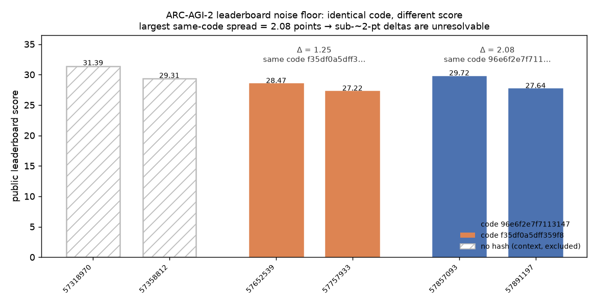

# ARC-AGI-2 Selector Surface and Leaderboard Noise Floor

[](https://github.com/aidless/arc2-selector-measurement/actions/workflows/ci.yml)

**A measurement-discipline contribution for the [ARC Prize 2026 — ARC-AGI-2](https://www.kaggle.com/competitions/arc-prize-2026-arc-agi-2) Innovation Prize.**

This repository is the open-source artifact set for our ARC-AGI-2 writeup. It is deliberately **not** a high-scoring solution. It is the tooling and the measurements needed to tell a real selector effect apart from leaderboard noise.

---

## The headline result: the leaderboard has a 2.08-point noise floor

Two submissions carrying the same recorded code hash (`96e6f2e7f7113147`) scored **29.72** (ref 57857093) and **27.64** (ref 57891197).

```
Δ = 2.08 points from the same recorded code
```

A second same-hash pair (`f35df0a5dff359f8…`) scored 28.47 and 27.22 — Δ = 1.25 — so 2.08 is the largest observed spread, not a constant. An earlier pair from the same recipe scored 31.39 and 29.31, but neither recorded a hash; we treat that as weaker evidence and do not use it as a same-code bound.

On this benchmark, **any leaderboard delta below ~2 points is unresolvable noise.** Deployment is not evidence. This number is the most reusable thing we produced, and it is the reason we publish the selector surface rather than a score.



*The six leaderboard rows of `scores.json`, coloured by recorded code hash: two same-code
pairs (Δ = 2.08 and Δ = 1.25) and one un-hashed context pair (hatched, excluded from the
floor). Regenerate with `python3 analysis/plot_noise_floor.py` — the script reads
`scores.json` verbatim and retypes nothing.*

## The theory: the metric is a set function

The official caliber scores a pair **1 if either of the 2 predicted outputs exactly matches ground truth** — a pure OR over two attempts.

> **Proposition (selector objective).** Let a task have candidate pool *C* and score
> *s(pair) = 1[g₁ = y] OR 1[g₂ = y]*. Then *s* depends only on the **unordered set** {*g₁, g₂*},
> and *E[s] = P(∃ g ∈ S : g = y)* where *S = {g₁, g₂}*.
>
> 1. The **order** of the two attempts carries zero information.
> 2. Selection is therefore a **set-coverage** problem, not an attempt-**ranking** problem.
> 3. A gain is possible only if the second candidate is *genuinely different* — two
>    near-duplicate high-scoring candidates cover almost the same single output.

This is why the diversity constraint is the *natural* ablation rather than one heuristic among many, and why confidence-threshold selectors (`kgmon`) and count selectors can legitimately disagree: `kgmon` ranks, but the metric only cares about what the second slot **adds to coverage**.

## What is here

| Path | Contents |
|---|---|
| `src/arc_loader.py` | ARC task/grid loading, tokenization, augmentation |
| `src/arc_decoder.py` | **The selector surface** — `score_kgmon`, `score_count_plain`, `score_count_diverse`, `turbo_dfs`, `calc_scores` |
| `src/arc_solver.py` | Qwen3-4B SFT decoder wrapper, LoRA training path |
| `src/starter.py` | Multi-worker runner, time budgeting |
| `src/cell_03.py` | **Measurement switches** (`ARC_SELECTOR`, `ARC_COST_ORDER`, `ARC_SCORE_SALT`, `ARC_DEV_TASKS`) |
| `analysis/` | Exact sign test, selector recomputation, and the noise-floor computation |
| `dumps/` | Candidate dumps + per-pair labels (CC0) — see below |

## The selector surface

Three interchangeable selectors, selected by the `ARC_SELECTOR` environment variable:

| Selector | Behaviour | Status |
|---|---|---|
| `score_kgmon` | `len(guesses) − mean(score_aug)` — count minus mean augmentation NLL | v3 baseline signal |
| `score_count_plain` | Pure count-descending, kgmon NLL as tiebreak | **shipped default** (`ARC_SELECTOR=v2`) |
| `score_count_diverse` | Count-descending + normalized-Hamming diversity constraint (> 0.06) | Available (`ARC_SELECTOR=v2div`), **not** the default — see replication below |

## Measurement switches

Reproducible variants are defined by four environment variables, set in `src/cell_03.py`:

- `ARC_SELECTOR` — which selector to use
- `ARC_COST_ORDER` — `1` = cheap-tasks-first, `0` = fixed dictionary order
- `ARC_SCORE_SALT` — deterministic crc32 seed vs. salted `hash(task_id)`
- `ARC_DEV_TASKS` — task subset selector (dev mode only; ignored during competition rerun)

## Honest results: no selector survives cross-pool replication

We tested three selectors on three **real** candidate pools produced by separate runs.
The pools overlap (T3 full, n = 159, shares 99 keys with T4-rem108 and 56 with T4-n8;
T4-rem108 and T4-n8 are disjoint), so each pool is reported separately and the merged
pool is only a descriptive summary.

| pool | n | kgmon | count-desc | paired (count − kgmon) |
|---|---:|---:|---:|---:|
| T3 full | 159 | 22.64% | 22.01% | **+1 / −2** |
| T4-rem108 | 101 | 24.75% | 26.73% | +2 / −0 |
| T4-n8 | 57 | 26.32% | 26.32% | +0 / −0 |
| merged (descriptive) | 162 | 24.07% | 25.93% | +3 / −0 |

The merged row is the one that looks like a win, and the one that should be trusted
least: it is assembled from overlapping runs, so for 99 keys the candidate pool is
larger than any single run actually produced.

**On the largest single pool, count-desc is slightly worse than kgmon (+1/−2).**

So we ship `count-desc` as the default (`ARC_SELECTOR=v2`) because it is the simplest
deterministic rule — **not** because we demonstrated it is better. We could not
demonstrate that. This is the paper's point: at this sample size, selector effects sit
below both the leaderboard noise floor (2.08 points) and the cross-pool replication
threshold.

**The diversity constraint fails the same test, harder.** `ARC_SELECTOR=v2div` scored
+6/−0 on the merged pool but **+1/−4** on the largest single pool. It is not the default.

### Five negative results (each cost real compute, all reproducible)

1. Pure CPU program search: transform / neighbour / v1_dsl / dsl_expanded / v6_chain → **0/172** on eval-120.
2. 127-program DSL: eval **0/172**, train holdout 7/259, zero gain from families 10–12 (saturation).
3. Prompt-level LLM with 4k budget: 108 outputs, **all rejected** by grid validation.
4. Raising the per-task cap with water-fill scheduling: **−0.83**, an empty result.
5. kgmon vs. probmul selector A/B on 10 tasks: **1/10 vs 1/10**, identical per task.

**Environment consistency is not free.** The same 4 tasks pass **3/4** in the official Kaggle probe (transformers 4.55.4, GC=0) but only **1/4** on a local A10 (5.16.1, GC=1). Absolute scores are not comparable across environments; every cross-environment conclusion must be rejected.

## Lineage (fully attributed)

```
NVARC ARC'25 champion solution  (nihilisticneuralnet/baseline-nvarc-arc-25-winning-solution-for-t4x2)
  └─ koushikrudra/failed-in-aimo
        └─ mikelou1/arc-agi2-lb33-89-minimal-perfpatch   ← our base (LB 33.89)
              └─ liuzewen123/arc2-bronze-v7             ← this repository
```

- Base notebook: `mikelou1/arc-agi2-lb33-89-minimal-perfpatch` (public)
- Model: `sorokin/qwen3_4b_grids15_sft139` (Apache-2.0), a Qwen3-4B SFT decoder
- Runtime: 4× NVIDIA L4, 12 h submission budget

## Reproduction

1. Run the notebook `liuzewen123/arc2-bronze-v7` on Kaggle (4×L4). It writes `arc_loader.py`, `arc_decoder.py`, `arc_solver.py`, `starter.py` — the same files as `src/`.
2. Set the measurement switches in `src/cell_03.py` to define the variant.
3. Recompute the selector comparison from the released dumps:

```bash
kaggle competitions download -c arc-prize-2026-arc-agi-2 \
  -f arc-agi_evaluation_solutions.json

python3 analysis/recompute_selectors.py \
  --gt arc-agi_evaluation_solutions.json \
  --dumps dumps/preds_t3_full.candidates.json \
           dumps/preds_t4_remaining108.candidates.json \
           dumps/preds_t4_n8.candidates.json \
  --label merged
```

Expected output on the merged pool (162 items):

```
  kgmon     acc = 24.0741%  (39/162)
  count     acc = 25.9259%  (42/162)
  diverse   acc = 27.7778%  (45/162)
  kgmon -> count: +3/-0  sign p = 0.25
  kgmon -> diverse: +6/-0  sign p = 0.03125
```

4. Reproduce the noise floor:

```bash
python3 analysis/noise_floor.py scores.json
```

`scores.json` (committed) carries all six leaderboard rows, two same-code pairs plus one
un-hashed context pair — abbreviated here, see the file for the full notes:

```json
{"runs": [
  {"ref": "57652539", "code_sha256": "f35df0a5dff359f8", "public_score": 28.47},
  {"ref": "57757933", "code_sha256": "f35df0a5dff359f8", "public_score": 27.22},
  {"ref": "57857093", "code_sha256": "96e6f2e7f7113147", "public_score": 29.72},
  {"ref": "57891197", "code_sha256": "96e6f2e7f7113147", "public_score": 27.64}
]}
```

Verified 2026-11-10, clean checkout: the script prints both groups and their spreads —
`96e6f2e7f7113147 → 2.08`, `f35df0a5dff359f8 → 1.25` — and ends with
`NOISE FLOOR = 2.08 points`.

5. Run the same script on each independent pool separately to see the non-replication:

```bash
python3 analysis/recompute_selectors.py --gt arc-agi_evaluation_solutions.json \
  --dumps dumps/preds_t4_seed4321_first64.candidates.json --label seed4321
python3 analysis/recompute_selectors.py --gt arc-agi_evaluation_solutions.json \
  --dumps dumps/preds_t4_passb_first64.candidates.json --label passb
```

Both report `kgmon -> diverse: +0/-1` -- the reason `v2div` is not the default.

## Datasets and licences

- Code we authored (`analysis/`, `src/cell_03.py`, `scores.json`, this README, `LINEAGE.md`): **MIT-0** (see `LICENSE`).
- The other eight files in `src/`: **Apache-2.0**, inherited from the upstream notebook chain (see `LICENSE-APACHE-2.0` and `LINEAGE.md` for the per-file table).
- Candidate dumps and per-pair labels in `dumps/`: **CC0** (see `LICENSE-CC0`).
- The base notebook and model retain their own licences; see `LINEAGE.md`.

We split the licences this way on purpose. The ARC Prize 2026 rules require code and methods authored by the submitter to be released under a permissive public-domain licence (CC0 or MIT-0), while third-party components only have to carry an open-source licence that permits public sharing. The four `src/` modules above are derived from upstream notebooks and keep Apache-2.0; everything we wrote is MIT-0.

## Non-claims

We did not improve raw ARC-AGI-2 solve rate. We are not close to the leaders. The count-desc result is underpowered and sub-noise-floor. This repository is a contribution about how to *measure* selector changes, not a claim of a better solver.
